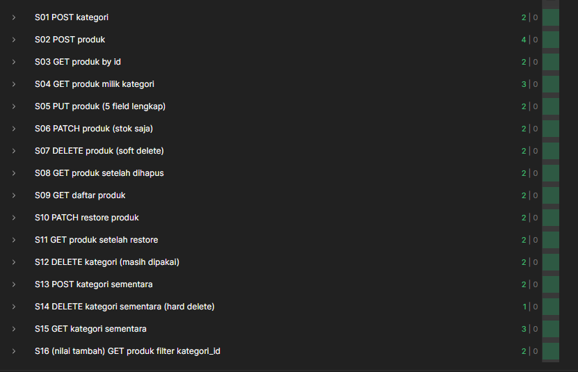
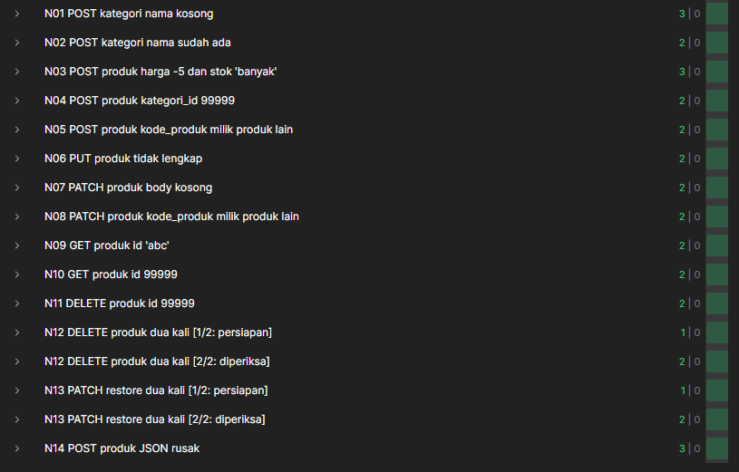
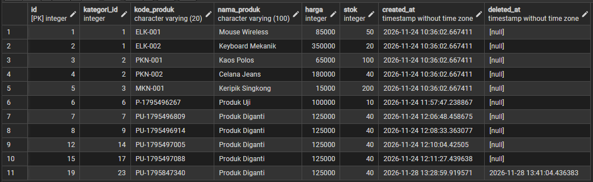
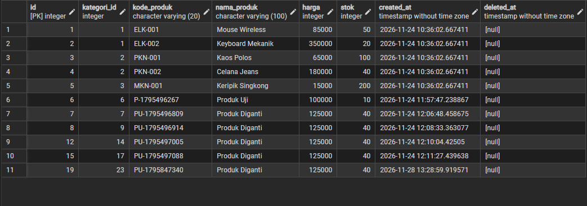
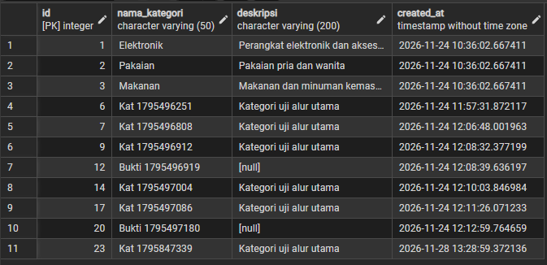

# UTS Pemrograman API: REST API Toko Online

REST API untuk dua resource yang berelasi one-to-many, dibangun dengan **Express.js** dan **PostgreSQL**.

- **kategori** (tabel induk): memakai **hard delete**
- **produk** (tabel anak): memakai **soft delete** dan endpoint restore

**Kelompok:** 3

| No | Nama | NIM |
|---|---|---|
| 1 | Daviq Cahyo | 24104410043 |
| 2 | Anisaturrohmah | 24104410044 |
| 3 | Cahyo Saputra | 24104410078 |
| 4 | Hardi Prayoga | 24104410079 |
| 5 | Putri Perwitasari | 24104410080 |

---

## 1. Cara Menjalankan Server

### Prasyarat
- Node.js (versi LTS) dan npm
- PostgreSQL yang sudah berjalan
- Postman (untuk pengujian)

### Langkah

1. **Clone repository dan install dependensi**
   ```bash
   git clone <url-repository>
   cd UTS-PemrogAPI-Kelompok3
   npm install
   ```

2. **Buat file `.env`** dari contoh, lalu isi `DB_PASSWORD` dengan password PostgreSQL kamu.
   ```bash
   # Windows (Command Prompt)
   copy .env.example .env
   # macOS / Linux
   cp .env.example .env
   ```
   Isi `.env`:
   ```
   PORT=3000
   DB_HOST=localhost
   DB_PORT=5432
   DB_USER=postgres
   DB_PASSWORD=isi_password_kamu
   DB_NAME=db_uts
   ```

3. **Buat database `db_uts`** (sekali saja), misalnya lewat pgAdmin atau psql:
   ```sql
   CREATE DATABASE db_uts;
   ```

4. **Buat tabel dan isi data awal**
   ```bash
   psql -U postgres -d db_uts -f sql/schema.sql
   psql -U postgres -d db_uts -f sql/seed.sql
   ```
   Alternatif lewat pgAdmin: klik kanan `db_uts` > Query Tool > buka `schema.sql` > Execute (F5), lalu ulangi untuk `seed.sql`. Urutannya harus `schema.sql` dulu. `schema.sql` memakai `DROP TABLE IF EXISTS`, sehingga aman dijalankan ulang untuk mereset data.

5. **Jalankan server**
   ```bash
   npm start        # mode biasa
   npm run dev      # mode pengembangan (nodemon, restart otomatis)
   ```
   Server berjalan di `http://localhost:3000`.

### Struktur Project

```
UTS-PemrogAPI-Kelompok3/
├── .env.example
├── .gitignore
├── package-lock.json
├── package.json
├── README.md
├── Postman/
│   ├── UTS-Local.postman_environment.json
│   └── uts.postman_collection.json
├── sql/
│   ├── schema.sql
│   └── seed.sql
└── src/
    ├── app.js            # menyusun aplikasi: express.json(), router, 404, error handler
    ├── server.js         # hanya menjalankan listen
    ├── config/db.js      # pg Pool, dibuat sekali, konfigurasi dari .env
    ├── routes/           # kategoriRoutes.js, produkRoutes.js
    ├── middlewares/      # parseId.js, validateKategori.js, validateProduk.js
    ├── controllers/      # kategoriController.js, produkController.js
    └── repositories/     # kategoriRepository.js, produkRepository.js
```

Pembagian tanggung jawab: **route** memetakan URL dan method, **middleware** memvalidasi input, **controller** membaca request dan mengirim response (tanpa SQL), **repository** satu-satunya tempat SQL (class, diekspor satu instance, semua query berparameter `$1, $2, ...`).

---

## 2. Rancangan Tabel dan Relasi

Satu kategori memiliki banyak produk (**one-to-many**): `produk.kategori_id` adalah foreign key ke `kategori.id`.

```
kategori (1) ───────< (N) produk
   id  <────────────  kategori_id
```

### Tabel `kategori` (induk)

| Kolom | Tipe dan constraint |
|---|---|
| id | SERIAL PRIMARY KEY |
| nama_kategori | VARCHAR(50) NOT NULL UNIQUE |
| deskripsi | VARCHAR(200), boleh kosong |
| created_at | TIMESTAMP NOT NULL DEFAULT NOW() |

### Tabel `produk` (anak)

| Kolom | Tipe dan constraint |
|---|---|
| id | SERIAL PRIMARY KEY |
| kategori_id | INTEGER NOT NULL, FOREIGN KEY ke kategori(id) |
| kode_produk | VARCHAR(20) NOT NULL UNIQUE |
| nama_produk | VARCHAR(100) NOT NULL |
| harga | INTEGER NOT NULL CHECK (harga > 0) |
| stok | INTEGER NOT NULL DEFAULT 0 CHECK (stok >= 0) |
| created_at | TIMESTAMP NOT NULL DEFAULT NOW() |
| deleted_at | TIMESTAMP NULL (NULL berarti aktif) |

---

## 3. Format Respons

**Sukses**
```json
{ "status": "success", "message": "...", "data": { } }
```
Respons daftar menambahkan field `count`. Soft delete dan hard delete yang sukses mengirim `204` tanpa body.

**Gagal**
```json
{ "status": "error", "message": "...", "errors": ["..."] }
```
Field `errors` hanya ada pada kegagalan validasi (400).

| Situasi | Status | Keterangan |
|---|---|---|
| Input atau format id tidak valid, JSON rusak | 400 | Validasi gagal |
| Data tidak ditemukan (termasuk produk yang sudah di-soft delete) | 404 | |
| Pelanggaran UNIQUE (23505), atau kategori masih dirujuk produk (23503 saat DELETE kategori) | 409 | |
| `kategori_id` tidak ada di tabel kategori (23503 saat INSERT/UPDATE produk) | 422 | |
| URL tidak dikenal | 404 | message `"Route tidak ditemukan"` |
| Kesalahan tak terduga | 500 | Pesan umum; detail hanya dicetak ke console |

---

## 4. Daftar Endpoint

### Kategori (hard delete)

| Method | URL | Fungsi | Status |
|---|---|---|---|
| GET | `/api/kategori` | Daftar semua kategori | 200 |
| GET | `/api/kategori/:id` | Detail satu kategori | 200, 400, 404 |
| POST | `/api/kategori` | Tambah kategori | 201, 400, 409 |
| DELETE | `/api/kategori/:id` | **Hard delete** (`DELETE FROM`) | 204, 400, 404, 409 |
| GET | `/api/kategori/:id/produk` | Produk aktif milik satu kategori (kosong tetap 200) | 200, 400, 404 |

**POST /api/kategori**
```json
{
  "nama_kategori": "Buku",
  "deskripsi": "Buku dan alat tulis"
}
```
Respons `201`:
```json
{
  "status": "success",
  "message": "Kategori berhasil ditambahkan",
  "data": { "id": 4, "nama_kategori": "Buku", "deskripsi": "Buku dan alat tulis", "created_at": "..." }
}
```

### Produk (soft delete)

| Method | URL | Fungsi | Status |
|---|---|---|---|
| GET | `/api/produk` | Daftar produk aktif beserta `count`. Filter opsional `?kategori_id=1` | 200, 400 |
| GET | `/api/produk/:id` | Detail satu produk aktif | 200, 400, 404 |
| POST | `/api/produk` | Tambah produk | 201, 400, 409, 422 |
| PUT | `/api/produk/:id` | Ganti seluruh data (semua field wajib) | 200, 400, 404, 409, 422 |
| PATCH | `/api/produk/:id` | Ubah sebagian field | 200, 400, 404, 409, 422 |
| DELETE | `/api/produk/:id` | **Soft delete** (mengisi `deleted_at`) | 204, 400, 404 |
| PATCH | `/api/produk/:id/restore` | Pulihkan produk yang di-soft delete | 200, 400, 404 |
| DELETE | `/api/produk/:id/permanent` | **Hard delete** produk, hanya untuk yang sudah di-soft delete (produk aktif dibalas 409) | 204, 400, 404, 409 |

**POST dan PUT /api/produk/:id** (kelima field wajib)
```json
{
  "kategori_id": 1,
  "kode_produk": "ELK-003",
  "nama_produk": "Headset",
  "harga": 150000,
  "stok": 10
}
```

**PATCH /api/produk/:id** (hanya field yang berubah)
```json
{ "stok": 40 }
```

**Aturan validasi**

| Resource | Field | Aturan |
|---|---|---|
| kategori | nama_kategori | wajib, tidak kosong, maksimal 50 karakter |
| kategori | deskripsi | opsional, maksimal 200 karakter |
| produk | kategori_id | bilangan bulat >= 1 |
| produk | kode_produk | wajib, tidak kosong, maksimal 20 karakter |
| produk | nama_produk | wajib, tidak kosong, maksimal 100 karakter |
| produk | harga | bilangan bulat > 0 |
| produk | stok | bilangan bulat >= 0 |

Semua kesalahan validasi dikumpulkan sekaligus pada array `errors`. Validasi di API memberi pesan yang ramah, sedangkan constraint database (UNIQUE, CHECK, FOREIGN KEY) menjadi pengaman terakhir.

---

## 5. Keputusan Desain

### a. Mengapa PUT dan PATCH sama-sama disediakan

- **PUT** mengganti seluruh data produk, sehingga kelima field wajib dikirim. Bila ada yang kurang, API menolak dengan 400, karena PUT yang tidak lengkap berarti sisa field dianggap hilang. PUT idempoten: mengirim data yang sama berulang kali menghasilkan keadaan akhir yang sama. Cocok untuk form edit penuh.
- **PATCH** hanya mengubah field yang dikirim, field lain tidak tersentuh. Body kosong `{}` ditolak 400. Cocok untuk perubahan kecil yang sering terjadi pada produk, misalnya hanya mengubah `stok` atau `harga`, dan mengurangi risiko menimpa data yang tidak dimaksud.
- Keduanya memakai pola dua fungsi validasi (`validateProduk` untuk POST dan PUT, `validatePatch` untuk PATCH). Pada PATCH, nama kolom pada query `UPDATE` hanya diambil dari daftar field yang diizinkan (`kategori_id`, `kode_produk`, `nama_produk`, `harga`, `stok`), sehingga client tidak bisa mengubah `id`, `created_at`, atau `deleted_at` lewat body. Nilai tetap dikirim lewat placeholder `$n`.

### b. Perilaku soft delete terhadap UNIQUE

`DELETE /api/produk/:id` hanya mengisi `deleted_at = NOW()`, barisnya tetap ada di tabel. API menganggap hanya baris dengan `deleted_at IS NULL` yang ada, sehingga filter ini dipasang pada GET daftar, GET by id, GET nested, PUT, PATCH, dan soft delete itu sendiri (soft delete kedua pada id yang sama dibalas 404).

Karena barisnya masih ada, **`kode_produk` milik produk yang di-soft delete tetap dianggap terpakai**: memakainya lagi pada produk baru dibalas **409**. Keputusan ini sengaja diambil:
- Constraint UNIQUE tetap sederhana dan berlaku untuk seluruh baris.
- **Restore selalu aman**: produk yang dipulihkan tidak akan pernah bentrok dengan produk baru yang memakai kode yang sama.
- Konsekuensinya, kode produk tidak bisa dipakai ulang selama barisnya belum dihapus permanen lewat `DELETE /api/produk/:id/permanent`.

Alternatif yang tidak dipilih: partial unique index (`UNIQUE ... WHERE deleted_at IS NULL`), yang membolehkan kode dipakai ulang tetapi membuat restore bisa gagal bila kodenya sudah dipakai produk lain.

### c. Perilaku soft delete terhadap foreign key

Produk yang di-soft delete **masih merujuk kategorinya**, karena barisnya tidak dihapus. Akibatnya, hard delete kategori tetap ditolak dengan **409 Conflict** selama masih ada produk yang merujuknya, termasuk produk yang sudah di-soft delete. PostgreSQL melempar error `23503`, yang ditangkap dan dibalas dengan pesan yang jelas, bukan 500. Agar kategori itu bisa dihapus, produk-produk yang merujuknya harus dihapus permanen terlebih dahulu.

Error `23503` yang sama muncul pada INSERT atau UPDATE produk bila `kategori_id` tidak ada di tabel kategori. Kodenya sama, tetapi operasinya berbeda, sehingga statusnya **422**.

### d. Mengapa tabel induk memakai hard delete

Kategori hanyalah data pengelompokan: ia tidak menyimpan riwayat transaksi, tidak perlu diaudit, dan tidak perlu fitur "batalkan hapus". Foreign key sudah melindungi kategori yang masih dipakai (409), sehingga data tidak bisa hilang secara tidak sengaja. Dengan hard delete, tabel tetap bersih dan nilai `nama_kategori` yang UNIQUE bisa dipakai lagi. Sebaliknya, produk adalah data bisnis yang bisa dirujuk data lain (misalnya transaksi) dan mungkin perlu dipulihkan, sehingga cocok memakai soft delete.

### e. Keamanan dan penanganan error

- Semua query berparameter (`$1, $2, ...`) untuk mencegah SQL injection.
- Format id divalidasi oleh middleware `parseId` (400), sehingga id seperti `abc` tidak sampai ke PostgreSQL dan memicu error 500.
- JSON rusak dibalas 400 oleh error handler terpusat; error tak terduga dibalas 500 dengan pesan umum, dan pesan internal PostgreSQL tidak bocor ke client.
- File `.env` tidak ikut ke repository (ada di `.gitignore`); yang dikumpulkan adalah `.env.example`.

---

## 6. Pengujian dengan Postman

File yang digunakan:
- `uts.postman_collection.json`: collection **UTS Pemrograman API**
- `UTS-Local.postman_environment.json`: environment berisi `baseUrl`, `kategoriId`, `produkId`, `kategoriSementaraId`, dan variabel bukti delete

Cara menjalankan:
1. Import kedua file ke Postman dan pilih environment **UTS Local**.
2. Pastikan server berjalan dan database dalam keadaan seed.
3. Jalankan folder **1-Alur Utama** lewat Collection Runner, lalu folder **2-Skenario Error**.
4. Folder **3-Bukti Delete** dijalankan manual (Send satu per satu) sambil memeriksa tabel di PostgreSQL.

Isi collection:
- **1-Alur Utama (S01-S15, ditambah S16 nilai tambah)**: alur normal dari membuat data, membaca, PUT, PATCH, soft delete, restore, sampai hard delete kategori. Aman dijalankan berulang karena nilai unik memakai `{{$timestamp}}`.
- **2-Skenario Error (N01-N14)**: validasi gagal, data ganda, kategori tidak ada, id salah format, id tidak ada, delete dan restore dua kali, serta JSON rusak.
- **3-Bukti Delete (B01-B09)**: membuktikan perbedaan soft delete dan hard delete di database.

---

## 7. Hasil Pengujian

### Collection Runner

| Folder | Tangkapan layar |
|---|---|
| 1-Alur Utama |  |
| 2-Skenario Error |  |

### Bukti Delete di Database (Folder 3)

| Keadaan | Tangkapan layar |
|---|---|
| Setelah soft delete: baris produk masih ada, `deleted_at` terisi |  |
| Setelah restore: `deleted_at` kembali NULL |  |
| Setelah hard delete: baris kategori sementara sudah tidak ada |  |
